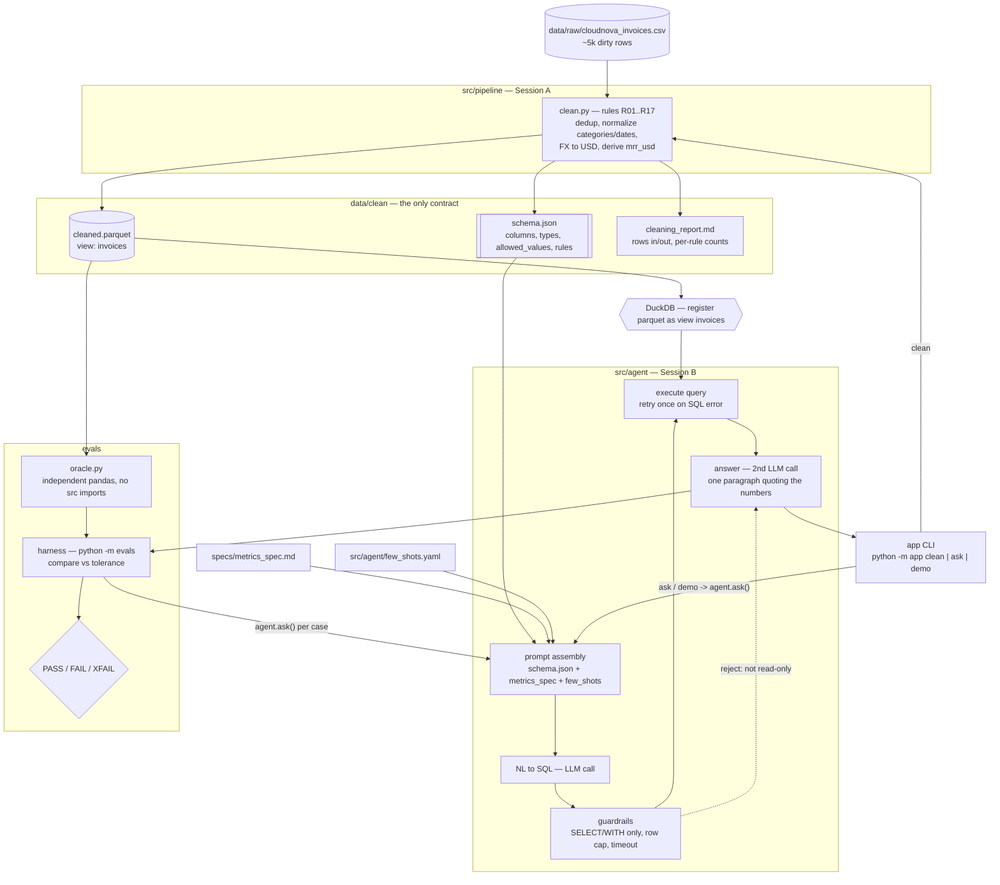

# CloudNova — System Architecture (Track B)

Data flows one way: a dirty CSV is cleaned by a spec-driven pipeline into a single
Parquet table plus a `schema.json` contract; the NL query agent reads that contract
at runtime, turns a question into guarded DuckDB SQL, and returns an answer with the
SQL shown. An independent oracle re-derives the expected metrics for the eval harness.

## How to read it

- **Contract boundary.** `data/clean/` is the *only* interface between the two halves.
  The pipeline writes `cleaned.parquet` + `schema.json` + `cleaning_report.md`; the
  agent reads `schema.json` at runtime and never hardcodes column names.
- **Agent path.** `schema.json` + `specs/metrics_spec.md` + `src/agent/few_shots.yaml`
  are assembled into the prompt → the LLM emits one SQL statement → guardrails reject
  anything that is not a single read-only `SELECT`/`WITH` → the query runs against the
  DuckDB `invoices` view under a row cap and timeout (one retry if it errors) → a
  second short LLM call turns the rows into a plain-English answer. `ask()` returns
  `{answer, sql, rows}`.
- **Entry point.** `python -m app` exposes `clean` (delegates to `python -m src.pipeline`),
  `ask "<q>"`, and `demo`.
- **Evaluation.** `evals/oracle.py` computes expected values independently (plain pandas
  over the Parquet, no `src/` imports) and the harness compares the agent's answer per
  case within tolerance — `PASS` / `FAIL` / `XFAIL` (one case, E05, is an expected fail).
